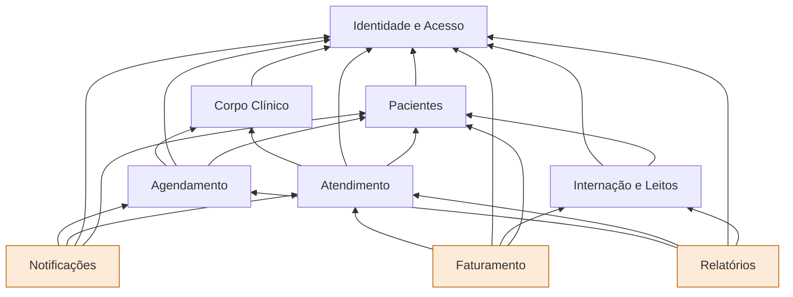
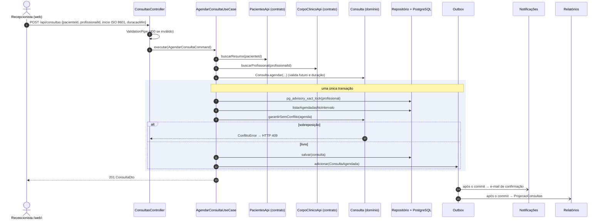
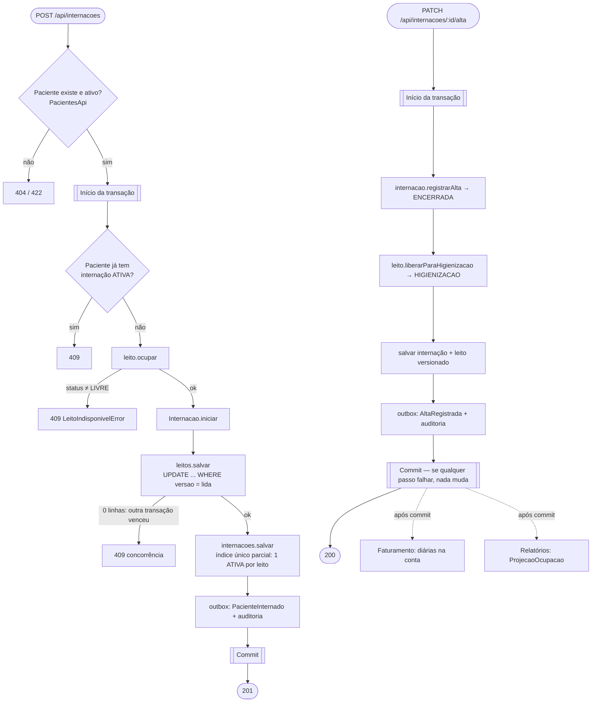

# SGH Connect — Sistema Integrado de Gestão Hospitalar

Trabalho da disciplina **Arquitetura de Software** (Uni-FACEF, 6º semestre, Prof. Carlos Alberto Lucas).
O objetivo é demonstrar **coesão, acoplamento e conascência** (Richards & Ford, *Fundamentos da Arquitetura de Software*)
em um sistema que funciona de verdade.

> **Projeto acadêmico.** Use somente dados fictícios. Não é um sistema para uso real em hospital.

**Sumário:** [Como rodar no seu computador](#como-rodar-no-seu-computador) ·
[O que testar](#o-que-testar-roteiro-de-demonstração) · [Problemas comuns](#problemas-comuns) ·
[Arquitetura](#arquitetura) · [Decisões (ADRs)](#decisões-arquiteturais-adrs) · [Diagramas](#diagramas) ·
[Evidências](#evidências-arquiteturais) · [Testes](#testes-e-verificações) · [Estrutura](#estrutura-do-repositório)

O documento arquitetural completo está em [`docs/SGH_Connect_Documentacao_Arquitetural.pdf`](docs/SGH_Connect_Documentacao_Arquitetural.pdf)
(versão editável em `.docx`).

---

## Como rodar no seu computador

Leva uns 10 minutos na primeira vez. Os comandos abaixo são para o **PowerShell** do Windows
(no Mac/Linux use o Terminal; a única diferença está no passo 3).

### 1. Instale os programas (só na primeira vez)

| Programa | Para quê | Onde baixar |
|---|---|---|
| **Git** | baixar o projeto | https://git-scm.com/downloads |
| **Node.js 20 ou mais novo** (versão LTS) | rodar a API e o site | https://nodejs.org |
| **Docker Desktop** | rodar o banco de dados PostgreSQL | https://www.docker.com/products/docker-desktop |

Depois de instalar, **abra o Docker Desktop** e espere aparecer *Engine running* (motor rodando).
Ele precisa ficar aberto enquanto você usa o sistema.

Para conferir se deu certo, abra o PowerShell e rode (cada um deve mostrar um número de versão):

```powershell
git --version
node -v
docker --version
```

### 2. Baixe o projeto

O repositório é público: não precisa de conta no GitHub. Escolha uma pasta (por exemplo, Documentos), abra o PowerShell nela e rode:

```powershell
git clone https://github.com/viniciuslprado/SGH-Connect.git
```

```powershell
cd SGH-Connect
```

### 3. Instale as dependências e crie o arquivo de configuração

```powershell
npm install
```

```powershell
Copy-Item .env.example apps/api/.env
```

> No Mac/Linux, o segundo comando é `cp .env.example apps/api/.env`.

### 4. Suba o banco de dados e carregue os dados de exemplo

Com o Docker Desktop aberto:

```powershell
npm run db:up
```

```powershell
npm run db:migrate
```

```powershell
npm run seed
```

O `seed` cria usuários, profissionais, 15 pacientes fictícios, 20 leitos e 8 consultas para o dia seguinte.
Ele **apaga e recria** os dados, então pode rodar de novo sempre que quiser voltar ao estado inicial.

### 5. Rode o sistema

```powershell
npm run dev
```

Espere aparecer `API em http://localhost:3333/api` no terminal e abra no navegador:

- **Sistema:** http://localhost:5173
- **Documentação da API (Swagger):** http://localhost:3333/api/docs

### 6. Entre com um dos usuários de teste

A senha de todos é **`sgh@2026`**. Cada perfil vê um menu diferente.

| Perfil | E-mail | O que dá para fazer |
|---|---|---|
| Administrador | `admin@sgh.local` | tudo: relatórios, usuários, auditoria, notificações |
| Recepcionista | `recepcao@sgh.local` | pacientes, agenda, abrir atendimento |
| Médico | `medico@sgh.local` ou `medica@sgh.local` | prontuário, finalizar atendimento, alta |
| Enfermeiro | `enfermeiro@sgh.local` | triagem, registro clínico, liberar leito |
| Gestor de leitos | `leitos@sgh.local` | mapa de leitos, internar, transferir, alta |
| Faturista | `faturamento@sgh.local` | contas hospitalares |

### 7. Para parar

No terminal do `npm run dev`, aperte **Ctrl + C**. Para desligar o banco:

```powershell
npm run db:down
```

Os dados ficam guardados. Da próxima vez basta abrir o Docker Desktop e rodar `npm run db:up` e `npm run dev`.

---

## O que testar (roteiro de demonstração)

1. **Recepção** → *Agenda* → agende uma consulta. Agende outra com o mesmo médico em horário sobreposto → aparece
   **"O profissional já possui consulta neste horário"** (HTTP 409).
2. **Médico** → *Atendimentos* → *Abrir atendimento* → *Prontuário* → inclua um registro clínico → *Finalizar*.
   O prontuário passa a recusar novos registros (HTTP 422).
3. **Faturista** → *Contas*: a conta do paciente apareceu **sozinha**. O Atendimento não conhece o Faturamento:
   ele só publicou o evento `AtendimentoFinalizado`.
4. **Gestor de leitos** → *Leitos* → *Internar* em um leito livre → *Alta* → o leito vai para higienização → *Liberar*.
5. **Administrador** → *Notificações* (e-mails simulados), *Auditoria* (inclui `PRONTUARIO_LIDO`, sem texto clínico) e *Início* (relatórios).
6. No terminal: `npm run arch:check` (fronteiras limpas) e `npm run arch:demo` (a regra reprovando uma violação proposital).

---

## Problemas comuns

| Sintoma | Solução |
|---|---|
| `error during connect` / `docker daemon is not running` | Abra o Docker Desktop e espere *Engine running*. |
| `port is already allocated` na porta 5433 | Outro programa usa a porta. Troque `5433` em `docker-compose.yml` e no `apps/api/.env`. |
| A página abre mas o login não funciona | Confira se o terminal do `npm run dev` mostra `API em http://localhost:3333/api` e se você rodou `npm run seed`. |
| `@prisma/client did not initialize yet` | Rode `npm run prisma:generate -w @sgh/api` e depois `npm run dev`. |
| `npm` não é reconhecido | Feche e abra o PowerShell depois de instalar o Node.js. |
| `git` não é reconhecido | Instale o Git e abra um novo PowerShell. Alternativa sem Git: no GitHub, *Code → Download ZIP*, extraia e abra o PowerShell dentro da pasta extraída. |

---

## Arquitetura

**Monólito modular**: um único deploy, dividido em **nove módulos de domínio**. Entre módulos só se importa a
pasta `contracts/` (interfaces, DTOs e eventos). Efeitos colaterais viajam por **eventos de domínio com outbox
transacional**. As fronteiras são verificadas automaticamente por `npm run arch:check`.

| Módulo | Pasta | Responsabilidade |
|---|---|---|
| Identidade e Acesso | `apps/api/src/modules/identidade` | login, JWT, perfis (RBAC) |
| Pacientes | `apps/api/src/modules/pacientes` | cadastro único do paciente, CPF |
| Corpo Clínico | `apps/api/src/modules/corpo-clinico` | médicos e enfermeiros |
| Agendamento | `apps/api/src/modules/agendamento` | agenda sem conflito de horário |
| Atendimento | `apps/api/src/modules/atendimento` | triagem, prontuário, finalização |
| Internação e Leitos | `apps/api/src/modules/internacao` | mapa de leitos, internação, transferência, alta |
| Faturamento | `apps/api/src/modules/faturamento` | conta hospitalar gerada por eventos |
| Notificações | `apps/api/src/modules/notificacoes` | e-mail (simulado) ao paciente |
| Relatórios | `apps/api/src/modules/relatorios` | indicadores a partir de projeções próprias |
| Kernel | `apps/api/src/shared` | transação, erros, eventos/outbox, auditoria |
| Compartilhado API + Web | `packages/shared` | enums e value object `Cpf` |

Cada módulo tem as camadas `api/ → application/ → domain/ ← infrastructure/`, mais `contracts/`.
O domínio é TypeScript puro (não importa NestJS nem Prisma).

**Tecnologias:** Node.js + NestJS + TypeScript, PostgreSQL 16 + Prisma (um schema por módulo),
`@nestjs/event-emitter` + tabela outbox, React + Vite, Jest + Supertest, Vitest, dependency-cruiser, Docker Compose.

---

## Decisões arquiteturais (ADRs)

| # | Decisão | Por quê | Trade-off aceito | Onde ver |
|---|---|---|---|---|
| 01 | **Monólito modular**, não microsserviços | trio, prazo curto, carga previsível, consistência forte em leitos e contas | escala e deploy só do sistema inteiro; mitigado: módulos falam como serviços | `apps/api/src/app.module.ts` |
| 02 | **Particionar por domínio**, camadas dentro do módulo | mudança fica em uma pasta; linguagem do hospital no código | alguma infraestrutura repetida entre módulos | regra `dominio-sem-framework` |
| 03 | **Contratos públicos** (`contracts/`) + injeção de dependência | acoplamento visível e verificável | mais código (DTOs, mapeadores) | `pacientes/contracts`, regra `somente-contratos-entre-modulos` |
| 04 | **Eventos de domínio com outbox** | módulos clínicos não dependem de Faturamento/Notificações/Relatórios | consistência eventual (~0,5 s) | `apps/api/src/shared/eventos` |
| 05 | **Um banco, um schema por módulo**, sem FK entre schemas | cada dado tem um dono; extração futura possível | integridade entre módulos via contrato, não via FK | `apps/api/prisma/schema.prisma` |
| 06 | **JWT + RBAC + auditoria** | dados de saúde (LGPD); API sem estado | revogar token na hora exigiria lista de bloqueio | `identidade/`, `shared/auditoria` |
| 07 | **Valores em centavos inteiros** no Faturamento | evita erro de ponto flutuante | conversão na borda | `faturamento/domain/conta.ts` |

---

## Diagramas

Os diagramas C4 (contexto, contêineres e componentes) estão no documento em `docs/` (imagens em `docs/diagramas/`).
Os diagramas abaixo são gerados ou conferidos a partir do código.

### Dependências reais entre módulos (gerado do código)

<!-- dependencias:inicio -->
> Gerado por `npm run arch:mermaid` em 2026-11-23 a partir das importações do código
> (dependency-cruiser). Uma seta A → B significa: algum arquivo de A importa `B/contracts`.
> Nenhuma seta aponta para fora de `contracts/`, e isso é garantido por `npm run arch:check`.



**Métricas de acoplamento medidas no código** (Ca = quantos módulos dependem dele; Ce = de quantos ele depende):

| Módulo | Ca (aferente) | Ce (eferente) | I = Ce/(Ca+Ce) |
|---|---|---|---|
| Identidade e Acesso | 8 | 0 | 0,00 |
| Pacientes | 5 | 1 | 0,17 |
| Corpo Clínico | 2 | 1 | 0,33 |
| Agendamento | 2 | 3 | 0,60 |
| Atendimento | 3 | 3 | 0,50 |
| Internação e Leitos | 2 | 2 | 0,50 |
| Faturamento | 0 | 4 | 1,00 |
| Notificações | 0 | 4 | 1,00 |
| Relatórios | 0 | 4 | 1,00 |

<details><summary>Arquivos que originam cada dependência</summary>

- **agendamento → corpo-clinico**: `agendamento/application/casos-de-uso.ts`
- **agendamento → identidade**: `agendamento/api/consultas.controller.ts`, `agendamento/application/casos-de-uso.ts`
- **agendamento → pacientes**: `agendamento/application/casos-de-uso.ts`
- **atendimento → corpo-clinico**: `atendimento/application/casos-de-uso.ts`
- **atendimento → identidade**: `atendimento/api/atendimentos.controller.ts`, `atendimento/application/casos-de-uso.ts`
- **atendimento → pacientes**: `atendimento/application/casos-de-uso.ts`
- **corpo-clinico → identidade**: `corpo-clinico/api/profissionais.controller.ts`
- **faturamento → atendimento**: `faturamento/application/casos-de-uso.ts`
- **faturamento → identidade**: `faturamento/api/contas.controller.ts`, `faturamento/application/casos-de-uso.ts`
- **faturamento → internacao**: `faturamento/application/casos-de-uso.ts`
- **faturamento → pacientes**: `faturamento/application/casos-de-uso.ts`
- **internacao → identidade**: `internacao/api/internacao.controller.ts`, `internacao/application/casos-de-uso.ts`, `internacao/application/internar-paciente.use-case.ts`
- **internacao → pacientes**: `internacao/application/casos-de-uso.ts`, `internacao/application/internar-paciente.use-case.ts`
- **notificacoes → agendamento**: `notificacoes/application/notificar-paciente.handler.ts`
- **notificacoes → atendimento**: `notificacoes/application/notificar-paciente.handler.ts`
- **notificacoes → identidade**: `notificacoes/notificacoes.module.ts`
- **notificacoes → pacientes**: `notificacoes/application/notificar-paciente.handler.ts`
- **pacientes → identidade**: `pacientes/api/pacientes.controller.ts`, `pacientes/application/casos-de-uso.ts`
- **relatorios → agendamento**: `relatorios/application/relatorios.ts`
- **relatorios → atendimento**: `relatorios/application/relatorios.ts`
- **relatorios → identidade**: `relatorios/relatorios.module.ts`
- **relatorios → internacao**: `relatorios/application/relatorios.ts`

</details>
<!-- dependencias:fim -->

### Sequência — agendamento de consulta



### Fluxo — internação e alta



---

## Evidências arquiteturais

Caminhos relativos a `apps/api/src/modules/` quando não indicado. Status observado na execução de 23/11/2026.

### Coesão

| Critério | Onde | Teste | Status |
|---|---|---|---|
| Um módulo por subdomínio do hospital | `apps/api/src/modules/*` (9 pastas) | `arquitetura.e2e-spec.ts` | ✅ |
| Regra da agenda dentro do domínio | `agendamento/domain/consulta.ts` (`garantirSemConflito`) | `consulta.spec.ts` | ✅ |
| Leito e Internação no mesmo módulo (mudam juntos) | `internacao/domain/leito.ts`, `internacao.ts` | `internar-paciente.use-case.spec.ts` | ✅ |
| Coesão sequencial do atendimento | `atendimento/domain/atendimento.ts` | `atendimento.spec.ts` | ✅ |
| Dinheiro só no Faturamento | `faturamento/domain/conta.ts` | `conta.spec.ts` | ✅ |
| Domínio sem framework | `*/domain/*.ts` | `npm run arch:check` | ✅ |
| Web com as mesmas fronteiras | `apps/web/src/modules/*` | `api.spec.ts` (web) | ✅ |

### Acoplamento

| Critério | Onde | Teste | Status |
|---|---|---|---|
| Só `contracts/` entre módulos | `.dependency-cruiser.cjs` | `npm run arch:check` → 0 violações | ✅ |
| A regra reprova violação | `apps/api/test/arch-fixture` | `npm run arch:demo` → 1 erro | ✅ |
| Sem ciclos | regra `sem-ciclos` | `npm run arch:check` | ✅ |
| Contrato + injeção | `pacientes/contracts/index.ts` (`PACIENTES_API`) | e2e de agendamento | ✅ |
| Eventos em vez de chamadas | `atendimento/application/casos-de-uso.ts` | e2e "Faturamento reage ao evento" | ✅ |
| Módulos de saída com Ca = 0 | seção [Diagramas](#dependências-reais-entre-módulos-gerado-do-código) | `npm run arch:mermaid` | ✅ |
| Relatórios sem JOIN em outros módulos | `relatorios/infrastructure/projecoes.repositorio.ts` | e2e de projeção | ✅ |

### Conascência

| Tipo | Onde | Decisão | Teste | Status |
|---|---|---|---|---|
| Nome | `pacientes/contracts/index.ts` (`PacientesApi.buscarResumo`) | mantida (contrato estável) | e2e | ✅ |
| Tipo | `atendimento/contracts/index.ts` (payload tipado) | mantida, verificada pelo TypeScript | `tsc` | ✅ |
| Convenção | `packages/shared/src/enums.ts` (`StatusLeito`…); datas ISO 8601 UTC | eliminada | `api.spec.ts` (web) | ✅ |
| Posição | `agendamento/application/agendar-consulta.command.ts` | reduzida para nome | e2e | ✅ |
| Algoritmo | `packages/shared/src/cpf.ts` (usado na API e no web) | eliminada | `cpf.spec.ts`, e2e 400 | ✅ |
| Execução | `atendimento/domain/atendimento.ts`; `internacao/application/internar-paciente.use-case.ts` | reduzida e confinada | e2e 422, teste em memória | ✅ |
| Temporal | `internacao/infrastructure/repositorios.ts` (versão); outbox; `prisma-conta.repositorio.ts` (idempotência) | reduzida | e2e concorrência, alta atômica, idempotência | ✅ |

### Segurança e qualidade

| Critério | Teste | Status |
|---|---|---|
| 401 sem token ou com token inválido | e2e | ✅ |
| 403 perfil sem permissão (recepção → prontuário, médico → fechar conta) | e2e | ✅ |
| 400 com mensagens claras (CPF inválido, data fora do ISO 8601) | e2e | ✅ |
| 409 conflito de agenda e de leito, inclusive com requisições simultâneas | e2e | ✅ |
| Alta atômica (falha simulada não altera nada) | e2e | ✅ |
| Auditoria sem texto clínico | e2e | ✅ |
| Mesmo evento entregue 2× não duplica conta nem notificação | e2e | ✅ |

### Capturas de tela sugeridas para o documento

1. Árvore `apps/api/src/modules` aberta no VS Code (seção 4.1).
2. `npm run arch:check` limpo e `npm run arch:demo` com erro, lado a lado (seção 6.4).
3. Diagrama de dependências desta página (seções 3.3 / 6.1).
4. `npm test` com todos os testes verdes (seção 13).
5. Agenda com a mensagem de conflito (seção 7.5).
6. Prontuário finalizado bloqueando novo registro (seção 7.7).
7. Conta gerada sozinha após finalizar o atendimento (seção 6.3).
8. Mapa de leitos e alta → higienização (seção 7.8).
9. Auditoria com `PRONTUARIO_LIDO` (seção 10).
10. Swagger em http://localhost:3333/api/docs (seção 2.3).

---

## Testes e verificações

```powershell
npm test
```

Roda, em ordem: testes do `packages/shared` (Vitest), unitários da API (Jest, sem banco), **e2e da API**
(Jest + Supertest contra o banco `sgh_test`, criado automaticamente pelo `db:up`) e testes do web (Vitest).
Resultado em 23/11/2026: **48 testes, 0 falhas** (4 + 18 + 22 + 4).

| Comando | O que faz |
|---|---|
| `npm run arch:check` | verifica as fronteiras entre módulos (dependency-cruiser) |
| `npm run arch:demo` | mostra a regra reprovando uma violação proposital |
| `npm run arch:mermaid` | regenera o diagrama de dependências desta página a partir do código |
| `npm run docs:word` | regenera o `.docx` do documento arquitetural |

---

## Estrutura do repositório

```
SGH-Connect/
├── apps/api/            NestJS + Prisma (monólito modular)
│   ├── src/modules/     9 módulos: api/ application/ domain/ infrastructure/ contracts/
│   ├── src/shared/      kernel: prisma, transação, erros, eventos/outbox, auditoria
│   ├── prisma/          schema (um schema por módulo), migrações e seed
│   └── test/            testes e2e e fixture de violação arquitetural
├── apps/web/            React + Vite (src/modules/* espelha os módulos da API)
├── packages/shared/     enums + Cpf (mesmo código na API e no web)
├── docs/                documento arquitetural (.docx/.pdf), diagramas e geradores
├── scripts/             gerador do diagrama de dependências
├── docker-compose.yml   PostgreSQL (porta 5433) + banco de testes
└── .dependency-cruiser.cjs  regras de fronteira entre módulos
```
