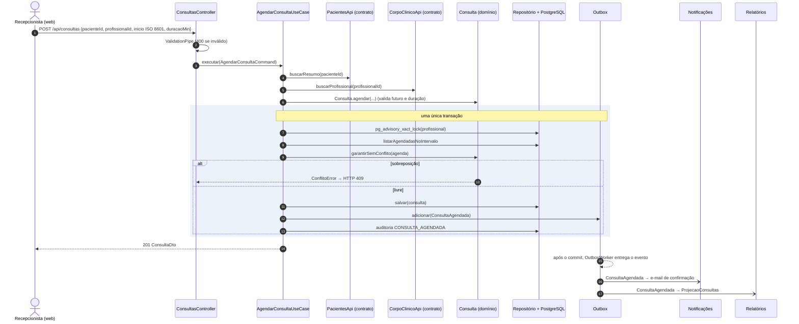
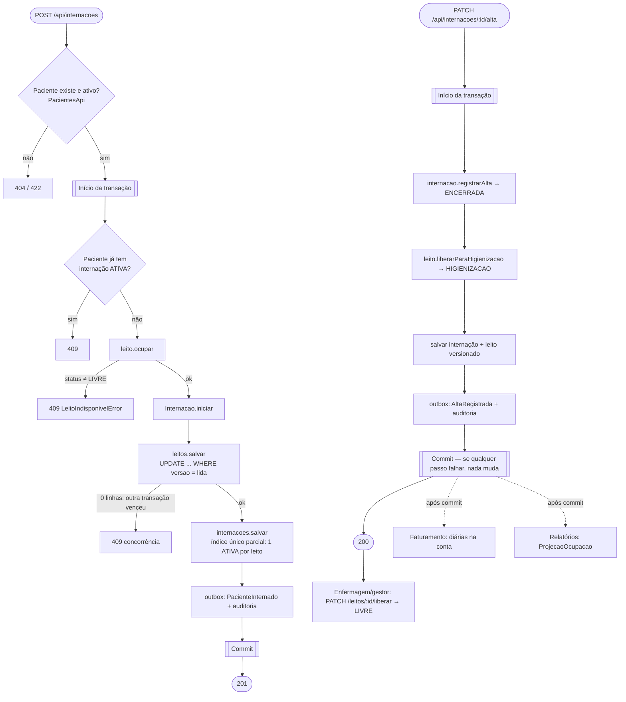
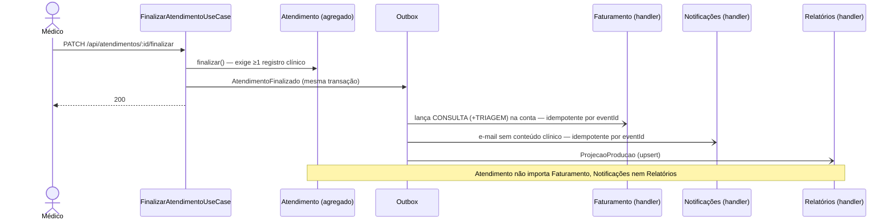

# Fluxos principais (Mermaid)

Diagramas conferidos com o código. Cada participante aponta para o arquivo que o implementa.

## 1. Sequência — agendamento de consulta

Arquivos: `agendamento/api/consultas.controller.ts` → `agendamento/application/casos-de-uso.ts` (`AgendarConsultaUseCase`)
→ `agendamento/domain/consulta.ts` → `agendamento/infrastructure/prisma-consulta.repositorio.ts`.

## 2. Fluxo — internação e alta

Arquivos: `internacao/application/internar-paciente.use-case.ts` e `internacao/application/casos-de-uso.ts` (`RegistrarAltaUseCase`),
`internacao/domain/leito.ts`, `internacao/domain/internacao.ts`, `internacao/infrastructure/repositorios.ts`.

## 3. Finalizar atendimento (eventos para módulos de saída)

