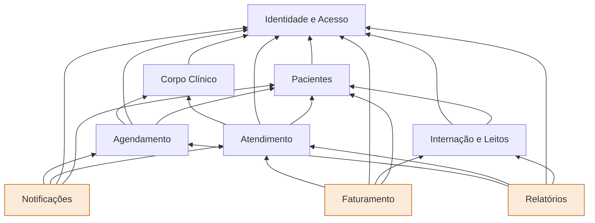

# Dependências reais entre módulos (gerado automaticamente)

> Gerado por `npm run arch:mermaid` em 2026-11-23T13:43:27.015Z a partir das importações do código
> (dependency-cruiser). Uma seta A → B significa: algum arquivo de A importa `B/contracts`.
> Nenhuma seta aponta para fora de `contracts/` — isso é garantido por `npm run arch:check`.

## Métricas de acoplamento calculadas do código

| Módulo | Ca (aferente) | Ce (eferente) | I = Ce/(Ca+Ce) |
|---|---|---|---|
| Identidade e Acesso | 8 | 0 | 0,00 |
| Pacientes | 5 | 1 | 0,17 |
| Corpo Clínico | 2 | 1 | 0,33 |
| Agendamento | 2 | 3 | 0,60 |
| Atendimento | 3 | 3 | 0,50 |
| Internação e Leitos | 2 | 2 | 0,50 |
| Faturamento | 0 | 4 | 1,00 |
| Notificações | 0 | 4 | 1,00 |
| Relatórios | 0 | 4 | 1,00 |

## Arquivos que originam cada dependência

- **agendamento → corpo-clinico**: `agendamento/application/casos-de-uso.ts`
- **agendamento → identidade**: `agendamento/api/consultas.controller.ts`, `agendamento/application/casos-de-uso.ts`
- **agendamento → pacientes**: `agendamento/application/casos-de-uso.ts`
- **atendimento → corpo-clinico**: `atendimento/application/casos-de-uso.ts`
- **atendimento → identidade**: `atendimento/api/atendimentos.controller.ts`, `atendimento/application/casos-de-uso.ts`
- **atendimento → pacientes**: `atendimento/application/casos-de-uso.ts`
- **corpo-clinico → identidade**: `corpo-clinico/api/profissionais.controller.ts`
- **faturamento → atendimento**: `faturamento/application/casos-de-uso.ts`
- **faturamento → identidade**: `faturamento/api/contas.controller.ts`, `faturamento/application/casos-de-uso.ts`
- **faturamento → internacao**: `faturamento/application/casos-de-uso.ts`
- **faturamento → pacientes**: `faturamento/application/casos-de-uso.ts`
- **internacao → identidade**: `internacao/api/internacao.controller.ts`, `internacao/application/casos-de-uso.ts`, `internacao/application/internar-paciente.use-case.ts`
- **internacao → pacientes**: `internacao/application/casos-de-uso.ts`, `internacao/application/internar-paciente.use-case.ts`
- **notificacoes → agendamento**: `notificacoes/application/notificar-paciente.handler.ts`
- **notificacoes → atendimento**: `notificacoes/application/notificar-paciente.handler.ts`
- **notificacoes → identidade**: `notificacoes/notificacoes.module.ts`
- **notificacoes → pacientes**: `notificacoes/application/notificar-paciente.handler.ts`
- **pacientes → identidade**: `pacientes/api/pacientes.controller.ts`, `pacientes/application/casos-de-uso.ts`
- **relatorios → agendamento**: `relatorios/application/relatorios.ts`
- **relatorios → atendimento**: `relatorios/application/relatorios.ts`
- **relatorios → identidade**: `relatorios/relatorios.module.ts`
- **relatorios → internacao**: `relatorios/application/relatorios.ts`
